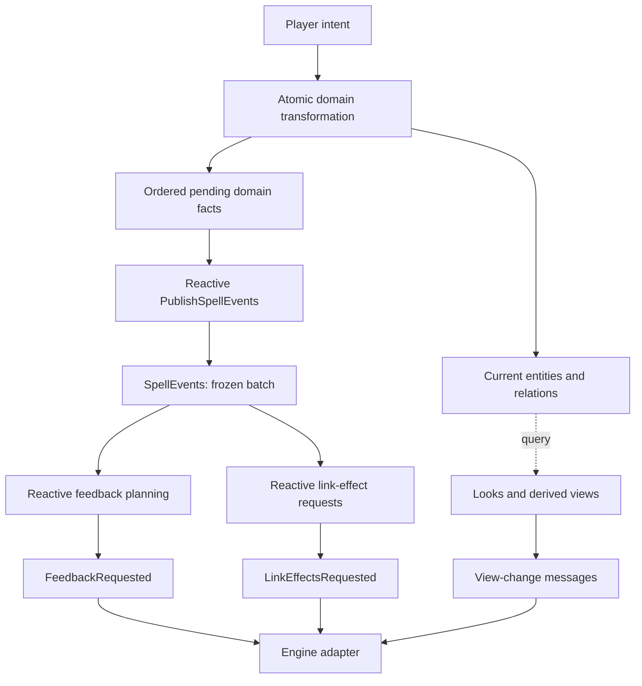

# Spellcasting, feedback and sympathy

This informative example puts game rules in Mud. Entities incorporate the
Spellcaster capability; a link is a domain relation, and engine effects are
requests to an adapter. It is not an executable Unity port or a language rule.

```mud
(MagicWorld, Player).SelectSpell(Spell.Sympathy)
(MagicWorld, Player).Cast(Aim(Point3(r0, r0, r0), [BoxA]))
(MagicWorld, Player).Cast(Aim(Point3(r0, r0, r0), [BoxB]))
(MagicWorld, BoxB).Invert(1)
(MagicWorld, Player).CancelSpell(Spell.Sympathy)
```

These are effect fragments inside an admitted then. Start a fresh world with
Entity, Creature, Spellcaster, Magic, MagicWorld, Player, BoxA and BoxB, plus
CanSelect, CanAttempt, TargetUsable, CanLink, ConcentrationWithinLimit,
ExclusiveSympathy and PublishSpellEvents. Add PrepareLinkEffects for engine
requests. Boolean rules must remain active: inactive-call pruning must not
silently remove mandatory domain checks. Message declarations are not lifecycle
targets. The full rule set is explicit in every source scenario.

## Entities, values and authority

Player is one entity that is both Creature and Spellcaster. Turret is another
entity with Spellcaster capability; neither needs an extra caster identity.
Their inherited fields are independent. Shape, position and own effects belong
to the entity. Selection, preparation and concentration belong to its spell
capability. An abstract thing is a shared schema; an alias is an immutable
value, not a mutable object with methods.

Magic owns links and finite delivery buffers, not copies of every entity.
SympathyLink is an identified relation with an owner, directed endpoints and
supported effect kinds. Its id stays fixed on inversion. nextLink allocates
fresh model data keys during serial domain mutations; it is not a native
address or a dynamic thing allocation. There is no class/instance interpretation
of create. The example does not supply a concurrent allocation algorithm.

The stored owner component explicitly retains Spellcaster [mut] authority from
the casting action's for role. That permission is used when a departing endpoint
must release the owner's reservation. It does not grant authority over the
other endpoints. Public facts and queries construct separate LinkSnapshot values
with read-only participants; they never export the operational link's authority.

## Selection and attempt contracts

Selection activates a configured, unlocked spell and reserves concentration
immediately. An already active selection toggles cancellation before applying
new-selection admission. Selection rejection is a normal domain occurrence,
not an IfRefusal. Concentration is derived from active spells, not link count.
ConcentrationWithinLimit checks the bound; it performs no repair.

The implemented provider is Sympathy. Fireball is a reserved catalog entry,
not an implemented spell body. The default entities configure only Sympathy.
InstantProtocolCaster exists solely to test the provider-independent completion
contract through ResolveAttempt; no public action accepts a C# result as the
implementation of a spell. Additional providers must supply their own Mud body
and registration/routing rather than inheriting an invented Fireball algorithm.

| Attempt | Domain outcome |
| --- | --- |
| No selected available provider | No attempted occurrence. |
| No hit | None, preserving the selected spell. |
| Present target unsuitable for Sympathy | Failed; it is not stored as the first participant. |
| First usable target | Partial; remember preparation without reserving the endpoint. |
| Revalidated compatible pair | Success; establish a link and end targeting. |

An available Sympathy target is present, shaped, supports an effect kind and
is not already in a link. Completion rechecks both participants, distinct
identity, shape equality and nonempty shared capabilities. A different caster
may prepare the same endpoint; only a completion that still passes these checks
can establish a link. Losing shape/capabilities or becoming occupied between
the two attempts cannot bypass revalidation.

No hit, failure or partial progress acquires another concentration reservation.
Success clears selection and preparation but keeps concentration while Sympathy
remains active. ResolveAttempt also states the protocol for an instant provider:
its success releases that spell's activity. Relocking changes future availability
without cancelling active spells, and never makes cancellation impossible.

## Relations, departure and derived contributions

An entity belongs to at most one active Sympathy link, in either role.
ExclusiveSympathy checks this condition at checkpoints. Initial orientation
prefers a grabbed second participant over an ungrabbed first one. Later changes
to grabbed do not reorient an existing relation. Invert checks that the supplied
participant is its current follower; there is no cached interactor permission.

Cancellation removes the owner's relation, clears the corresponding selection
and preparation, and releases activity. A second cancellation produces no extra
Cancelled or Unlinked fact. No permanent stopped-session registry is needed.

LeaveWorld removes affected links and releases their owners in the same domain
transformation, ends any remaining spells of a departing spellcaster, then sets
present=false. This is game-world presence, not Mud
create/destroy: canonical identity and stored data remain available. A bridge
must translate native departure/destruction through that input before treating
it as domain absence. Relations are not left invalid for a later repair wave.
A prepared object departing does not end the spell: the preparation view excludes
absent objects and a subsequent valid target can start preparation again.

EffectiveEffects returns separate own effects and link-origin borrowed groups.
A borrowed group includes its link id, source entity and source effect keys.
Its values are read from the leader's current OWN effects on each query.
No follower effect is overwritten, copied, given another timer or relayed onward.
Contributions with the same kind keep their separate origins; no universal
sum/max/replace rule is inferred. Ending a link removes its contributions;
inversion changes their direction without leaving old mirrors behind.

Sympathy queries leading/following links and currently invertible ids.
Targeting derives visibility and preparation from current state. Neither roles
nor the targeting view require mutable caches. EffectiveEffectsChanged and
TargetingChanged notify changes of those views; initial synchronization uses
the corresponding look because changes has no initial pulse.

## Facts and causal consequences



A root transformation captures facts with their aim and context when they occur.
Equal facts remain distinct entries. PublishSpellEvents drains pending into a
replaceable published batch; a message is sourced from that actual firing.
It is not emitted by a new instruction, and actions are not trigger sources.
Consumers use a matched message descriptor's frozen payload, not a later read
of the delivery buffer. A clear-to-empty observation does not publish another
batch because the publishing rule has a nonempty guard.

The buffers are finite current delivery batches, not an execution history.
Separate child calls may publish separate batches; published must never be used
to count all occurrences of a multi-call sequence. Internal consumers run through
the existing next-wave interface; checkpoint, rollback and host-ticket contracts
remain those of the specification. The example does not implement Q-072's causal
algorithm or promise exactly-once delivery to an external renderer.

Feedback configuration uses exact tables for associations, with functional
policies only for computed selection. Selected/cancelled/cast feedback requires
a spell profile; rejection fallback is independent. Each merge deduplicates
assets, excludes only the global origin, and allows specifics to reincorporate
an excluded asset. Rejection fallback keeps order and repetitions. Success
requests Partial then Success phases; the same asset in both is requested twice.
There is no promised order within a phase's asset set. Empty work is not emitted.
The channels are filtered by caster identity, not names or native callbacks.

## Engine boundary and limits

Physics, VFX, resource handles and native hosting stay outside the domain.
LinkEffectsRequested describes creation, inversion and removal by stable link id;
its snapshots retain the orientation at each occurrence. FeedbackRequested
carries captured aim/context and ordered phases. An adapter maps entity and asset
identities to engine resources, supplies the actual native error/lifetime and
rollback contracts, and manages rendering resources. Native execution is not
confirmed merely because a request was published.

Electricity is excluded. Motion is an adapter capability; SharedEffects is the
Mud projection described above. Native tag subscriptions, CTS ownership,
Rigidbody constraint implementations and the old C# cancellation reentry are
not reproduced. There is no duplicate-callback cancellation protocol to preserve.

Inputs in these examples are serialized and the required rules stay active
until causal consequences settle. The global exclusivity and concentration
checks remain required; no later wave may repair a failed checkpoint. Concurrent
intent allocation, native delivery failure/retry and missing/resumed observation
episodes require the existing operational/adapter contracts, not guessed behaviour
from this example. The normative language specification is unchanged.

## Files and verification

- controller.mud: capability, selection, completion protocol and typed domain facts.
- sympathy.mud: pair admission, relations, departure, contribution queries and link requests.
- feedback.mud: exact configuration tables, phase policies and causal feedback consumers.
- reactive-presentation.mud: derived views and their change notifications.
- scenarios.mud, sympathy-scenarios.mud and feedback-scenarios.mud: declarative contracts.
- domain-scenarios.mud: cross-entity exclusivity, revalidation, live contributions,
  inversion, departure, relocking, idempotence and frozen link-effect contexts.
- mud.part: this example part has no foreign dependencies.

The source scenarios are not executed tests: no Mud compiler/runtime exists here.
Repository validators check specification artefacts; bounded grammar witnesses
check preclassified fragments, not full source typing or native execution.
Unity is read-only and was not built or run. This exercise evaluates domain
modelling and current Mud constructs, not an implemented game or adapter.
